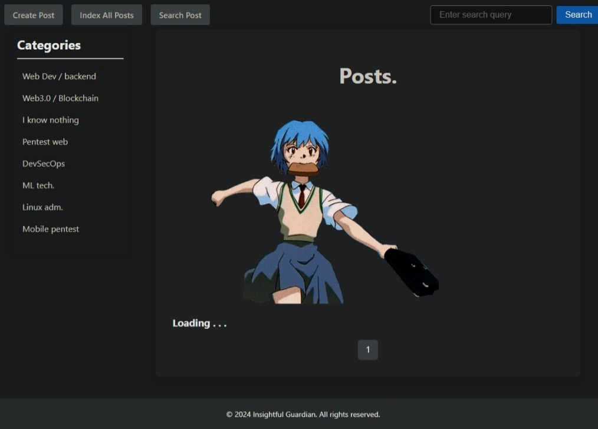

# Insightful guardian
<!--  -->

This is a repository created for learning goals, I'm actually trying to create an analog of telegra.ph, but with a different content moderation and search. I see the problem and try to fix it, but there is no docker image or anything else that can be deployed on a production server. Where I know how to do more efficiently I write, otherwise I ask generative AI. 
There's fullstack development on `Litestar`, `React`, `MongoDB`.

[docs/architecture.md](docs/architecture.md)

[docs/contribution.md](docs/contribution.md)

## Requirements
### Backend

| library | version | why |
| --- | --- | --- |
| poetry | - | to install all |
| python | >=3.13,<3.14 | stable python version |
| litestar[standard] | ^2.25.0 | async API backend |
| motor | ^3.7.1 | async mongodb |
| faker | ^25.2.0 | generate test data |
| pandas | ^2.2.2 | load and process signatures |
| better-profanity | ^0.7.0 | moderate by lib |

### Frontend

| library | version | why |
| --- | --- | --- |
| bun | - | to install all |
| axios | 1.20.0 | aio http requests |
| react | 19.3.1 | base front framework |
| react-dom | 19.3.1 | render DOM api |
| react-router-dom | 7.18.4 | front endpoints |
| vite | 8.3.4 | build tool and dev server |
| vitest | 5.0.4 | test framework |
| oxlint | 1.88.0 | Oxc linter |
| react-markdown | 10.1.0 | markdown rendering |
| react-toastify | 11.1.0 | toast notifications |
| react-hot-toast | 2.6.1 | hot toast notifications |
| sass | 1.105.1 | sass/scss support |

## Install and use
### Backend
clone repo
```bash
git clone https://github.com/YarBurArt/insightful_guardian.git
```
```bash
cd insightful_guardian
```
install poetry for py3 dependencies
```bash
pip install poetry 
```
install python dependencies
```bash
poetry install  
```
mongodb is configured for local connection, if sqlite or postgres then setup env variables in backend for DB connection like
```env
DB1_NAME=web_db
DB1_USER=web_service
DB1_PORT=1234
DB1_PASS=password
DB1_HOST=ip
DB1_PATH=db.sqlite    # optional 
DB_ENGINE=postgresql  # or sqlite
``` 

run backend through uvicorn in poetry shell 
```bash
poetry shell 
```
```bash
py backend/main.py
```
### Frontend
```bash
cd frontend
```
install react/js dependencies
```bash
bun install
```
run react front (as a separate server via Vite)
```bash
bun start
```
lint the frontend with Oxc
```bash
bun run lint
```

Closing is better to start with the frontend, then the backend, then the environments.
I write tasks directly in the code via TODO: for convenience and clarity. Just relax, I know it's not the best code, but it works well enough
